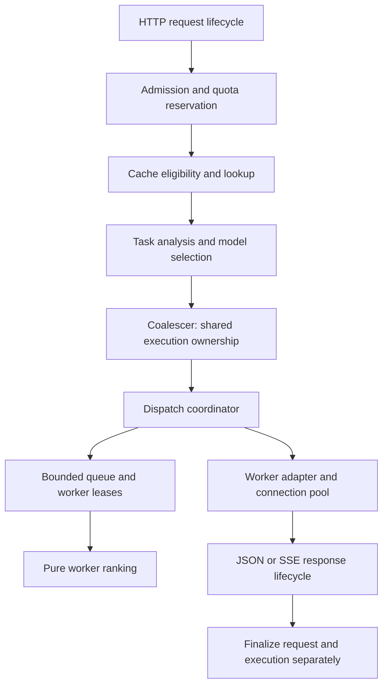

# Vane architecture refinements

Status: proposed design refinements; runtime implementation is pending. Read with [SPEC.md](SPEC.md) and [IMPLEMENTATION.md](IMPLEMENTATION.md). This document identifies decisions to incorporate into the relevant phases; it does not claim the gateway already implements them.

## 1. Keep the single-process design, clarify ownership

The existing separation between model selection and worker routing is valuable. Keep the modular monolith and four swappable routing strategies. The main improvement is to give mutable resources one owner and hide lifecycle details behind small module interfaces.



| Module               | Owns                                              | Interface responsibility                                           |
| -------------------- | ------------------------------------------------- | ------------------------------------------------------------------ |
| Request lifecycle    | Client signal, response state, request decision   | Finish one client request exactly once                             |
| Admission            | Key/global counters and quota reservations        | Return a reservation with idempotent settlement                    |
| Model selector       | Compatibility and ranking computation             | Return ordered models and reasons from an immutable snapshot       |
| Dispatch coordinator | Attempt budget, fallback, backoff and queue waits | Execute a ranked model plan within a deadline                      |
| Worker registry      | Capacity and half-open trial leases               | Atomically reserve eligible worker capacity and release once       |
| Coalescer            | Shared execution controller and waiter membership | Cancel execution only after its last waiter leaves                 |
| Config manager       | Versioned snapshots and pool generations          | Publish a validated snapshot; retire resources after leases finish |
| Observability        | Bounded histories and aggregates                  | Record immutable outcomes without blocking cleanup                 |

Strategies return a worker ID from read-only candidate snapshots. They never mutate counters or breakers. Registry reservation rechecks eligibility and reserves capacity synchronously before any asynchronous I/O. Dispatch, not each route or adapter, owns retries. Keep these as modules inside the gateway rather than adding network services.

Keep transport/config DTOs in `packages/shared`. Gateway-only signals, leases, mutable registries and dispatch contexts belong inside `apps/gateway`; the dashboard should not depend on execution internals.

## 2. Separate client requests from upstream executions

The current one-request/one-finalize rule is insufficient for coalescing. A shared execution can outlive the original client.

- Every client request has its own ID, deadline, admission reservation and decision record.
- Every shared execution has an execution ID, independent abort controller, bounded lifetime and attempt list.
- Each attempt owns one worker lease; its finalizer releases that lease even if response writing fails.
- A waiter deadline removes that waiter only. New followers do not extend the shared execution lifetime indefinitely.
- When the last waiter leaves, abort upstream work. Gateway shutdown can abort the shared execution directly.
- Observability failure must not prevent lease release or quota settlement.

Add `executionId`, `configVersion`, outcome and optional attempt summaries to decisions. Permit absent task/model fields on early authentication or schema errors instead of inventing a selected model. Record client HTTP status separately from stream outcome: HTTP 200 can contain an interrupted stream.

**Proof:** leader abort with two followers, all-waiter abort, follower timeout, shutdown and telemetry failure each release the correct resources exactly once.

## 3. Make capacity and quota reservations explicit

Use idempotent reservation handles rather than public increment/decrement methods. Keep worker capacity and breaker trial admission in one operation. Queued work owns client admission but no worker slot. Never hold a worker slot during retry backoff.

Reserve estimated tokens after a cache miss. Define these accounting rules before Phase 14:

- Refund unused reservations when actual usage is known; settle any excess usage as debt rather than silently discarding it.
- If generation began but usage is unknown, retain a conservative estimated charge and flag it as estimated. A client abort must not grant free generation.
- Separate logical per-client quota usage from physical upstream tokens. Coalesced callers consume their own logical quota; upstream token metrics count the shared execution once.
- Reject a request whose reservation exceeds bucket capacity with a clear limit error; do not calculate a finite refill time for an impossible reservation.
- Track retry attempts separately so backend work from unsuccessful attempts remains visible even when final usage is unavailable.

Use monotonic elapsed time for refill, deadlines and retry windows. Wall-clock timestamps remain useful for logs and externally reported times.

## 4. Define streaming commitment and measurements precisely

Use explicit states: `pending`, `committed`, `completed`, `interrupted`, `cancelled`. Before commitment, dispatch may retry. Once client headers/body are committed, no replacement attempt is permitted. Heartbeats must not commit an otherwise pending response.

Distinguish:

- Upstream response headers received.
- First upstream body byte received.
- First model content/tool delta received (TTFT).
- First client byte written.

An SSE comment or role-only chunk is not a generated token. If exact token-event detection requires parsing, parse bounded events until the first meaningful delta; do not label transport latency as TTFT. Bound an individual SSE event so a missing delimiter cannot grow memory indefinitely.

An upstream idle timeout must pause or be attributed appropriately when gateway reads are deliberately paused for client backpressure; otherwise a slow client incorrectly penalizes the worker. Client-stall timeout remains independent. Gateway-generated heartbeat writes do not reset upstream progress timers.

Do not send `[DONE]` after an interruption as though it succeeded. Cache only validated complete results. If downstream is already broken or stalled, an error event is best-effort; cleanup is mandatory.

**Proof:** split UTF-8/events, role-only deltas, comments, malformed/oversized events, EOF without completion, backpressure and client disconnect.

## 5. Make cache reuse compatible with policy changes

The fixed parameter list in the spec conflicts with passing through unknown OpenAI fields. Ignoring a new output-affecting field can return the wrong answer.

Canonicalize the complete effective inference payload after gateway metadata is removed. Exclude a field only when its lack of output effect is defined. Unsupported or unrepresentable payloads bypass reuse. Include endpoint, task hint, effective priority, requested model, namespace and a policy/model revision.

Authenticate and apply current model permissions before returning a cache hit. A cached `auto` result must not bypass a permission change or the current compatibility policy. Conservatively invalidating entries on relevant config changes is acceptable for v1.

Temperature zero and a seed are reuse eligibility policies, not guarantees that heterogeneous model servers produce identical output. Document that distinction. Treat tools conservatively as the spec requires.

For streaming cache replay, define the supported normalized response representation first. Multiple choices, tool deltas and multimodal output must either reconstruct losslessly or bypass caching. Preserve one schema version for entries; never cache partial reconstructions.

Coalescing keys additionally include resolved model and execution-affecting policy, including benchmark strategy overrides. Disable cache and coalescing during routing-only experiments.

## 6. Improve routing signals without biasing the experiment

Maintain worker-global capacity but latency/throughput statistics per worker and model. Otherwise a worker's slow large model contaminates routing for its fast small model. Count queue wait, upstream time and client delivery time separately. Client backpressure must not make a worker appear intrinsically slow.

Correct selector latency units:

```text
estimatedLatencyMs = ttftMs + 1000 * expectedOutputTokens / tokensPerSec
```

Guard missing/zero samples and stale observations. Start with measured baselines; record which estimates used live data. Retain the shared filter for all strategies, including recovery ramp-up and half-open limits.

Correct adaptive load precedence, but also establish telemetry semantics. Gateway in-flight requests may already include requests reported as waiting by the backend. Adding the entire backend queue can double-count them. For v1 use gateway in-flight divided by capacity as the default; expose backend queue pressure as a separate optional term with freshness metadata. Benchmark that term independently before enabling it by default.

Request priority in v1 controls model ranking. It does not imply queue priority. Keep FIFO initially; any deadline/fairness scheduler is a separate experiment.

## 7. Snapshot configuration and backend capabilities

Each request captures a config version. Reload builds replacement pools and validates references before publication. In-flight work retains its old generation; retired resources close after use, with a bounded retirement policy. Key revocation governs newly admitted requests; define immediate cancellation as a separate administrative behavior.

Resolve effective capabilities from model support AND adapter support. A model advertising JSON mode does not imply every backend version supports every JSON schema option. Prefer an explicit per-adapter parameter/capability policy over silently dropping unsupported fields. Unknown pass-through fields remain allowed only where the adapter can preserve them.

Task hints affect classification only. Always collect endpoint/payload requirements independently. Explicit model validation must include context size. Degraded workers remain eligible consistently in both selection and routing.

## 8. Protect benchmark validity

Run each strategy in a separate reset experiment. Header overrides are useful for selecting a run's strategy; interleaving strategies on the same active worker pool contaminates load, EWMA and breaker state.

- Save config, dependency lock hash, commit, seeds, workload trace, model/worker versions and machine allocation.
- Reset queues, breakers, caches, coalescing maps and statistics between runs; then perform identical warm-up.
- Use deterministic per-request random draws keyed by trace identity, not global RNG order affected by scheduling.
- Randomize strategy run order across repetitions and use paired comparisons over matching traces.
- Report scheduled arrivals, admitted requests, completions, rejects, timeouts, generator drops and unfinished requests.
- Report latency alongside failure rate; successful-only latency can look better simply because slow requests failed.
- Compute uncertainty across independent runs rather than treating every correlated request as an independent replicate.
- State whether physical CPU isolation was available; container CPU limits alone do not establish it.
- Compare baseline adaptive scoring with queue-pressure/cold-start variants as ablations.

The S4 expectation must be conditional: pre-stream recovery requires another eligible worker and enough retry/deadline budget. A single-worker crash cannot guarantee zero client-visible errors.

## 9. Additional features, in recommended order

These are optional proposals, not additions to v1 acceptance scope.

| Priority | Feature                             | Value                                                                          | Prerequisites and cost                                 | Completion evidence                                                                                         |
| -------- | ----------------------------------- | ------------------------------------------------------------------------------ | ------------------------------------------------------ | ----------------------------------------------------------------------------------------------------------- |
| 1        | Routing explanation view            | Show why each model/worker was excluded or selected                            | Extend bounded decision records; low/medium effort     | A failed route identifies capability, permission, health, capacity or breaker reason without prompt logging |
| 2        | Benchmark replay and comparison CLI | Make regressions and routing claims reproducible from one manifest             | Harness and versioned artifacts; medium effort         | Same manifest reproduces workload and emits paired comparison with uncertainty                              |
| 3        | Policy dry-run                      | Preview model/worker choices against a captured snapshot without upstream work | Pure selectors and admin authorization; medium effort  | No counters, breakers or queues mutate; clearly label predictions as hypothetical                           |
| 4        | Task quality evaluation runner      | Replace guessed quality scores with measured data                              | Curated datasets and scoring rules; medium/high effort | Scores link to dataset/model/prompt versions and feed selection with provenance                             |
| 5        | Deadline-aware admission            | Avoid accepting work unlikely to meet its remaining deadline                   | Calibrated latency estimates; medium/high effort       | Compare completion-before-deadline rates and rejection rates against FIFO                                   |
| 6        | Per-key queue fairness              | Prevent one busy key from occupying all waiting capacity                       | Admission/queue accounting; medium effort              | A noisy-client experiment demonstrates bounded waiting for other keys                                       |
| 7        | Token budget policy                 | Let keys impose output limits or estimated cost ceilings                       | Reliable usage and policy versioning; medium effort    | Explicit budget errors and reconciliation; never silently truncate requested output                         |

Start with explanation records and replay. They directly support the project's research question and make later features easier to evaluate. Delay automatic strategy switching, live shadow inference, semantic caching and multi-instance operation until the baseline measurements are credible. Shadow inference would generate additional real load and must not be mistaken for a passive comparison.

## 10. Implementation placement

| Existing phase | Refinement to include                                                                                |
| -------------- | ---------------------------------------------------------------------------------------------------- |
| 2–3            | Config versions, early-error decisions, gateway-local execution types, lifecycle ownership           |
| 4–5            | Adapter capability policy, commitment states, bounded SSE parsing, separate timing metrics           |
| 7–11           | Atomic worker leases, per-model statistics, idempotent release, monotonic deadlines                  |
| 12–13          | Capability collection independent of hints; corrected latency units and missing-data rules           |
| 14–15          | Quota settlement, unknown usage policy, versioned full-payload cache keys, shared execution lifetime |
| 16–17          | Config generations, bounded retirement, separate request/execution/attempt telemetry                 |
| 18             | Comparable candidate filtering, queue double-count avoidance and measured adaptive terms             |
| 20–22          | Isolated runs, paired comparisons, conditional recovery acceptance and full failure accounting       |

Do not add all suggested features before finishing the existing phases. Resolve the lifecycle, reuse and experiment rules first; they determine whether the rest of the design can be trusted.
